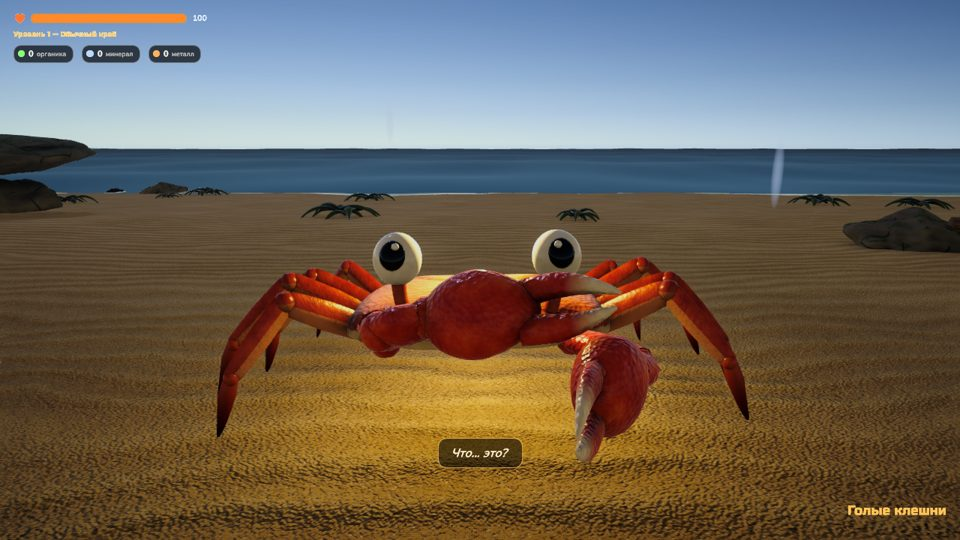
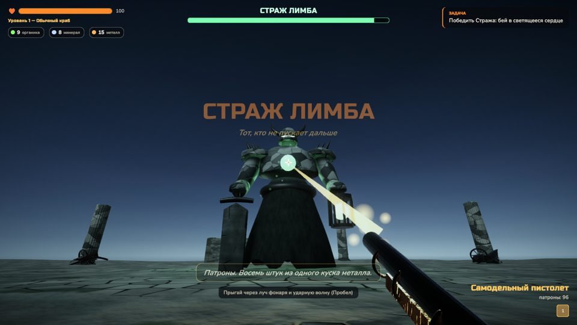
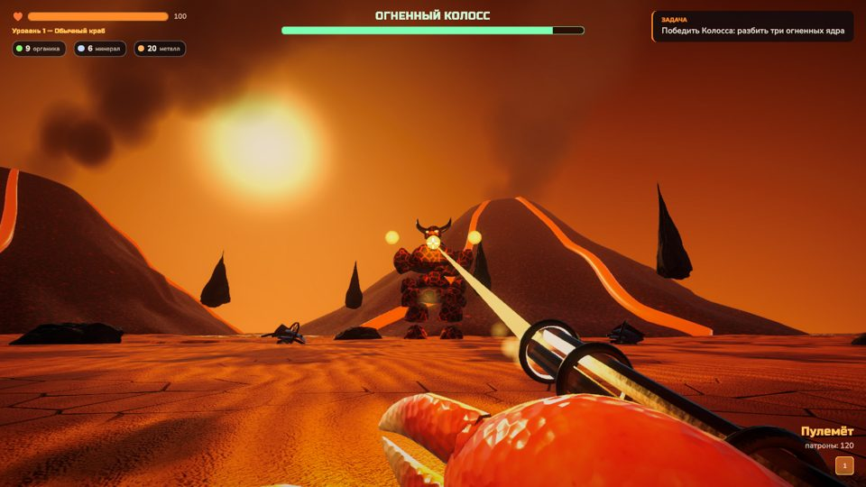
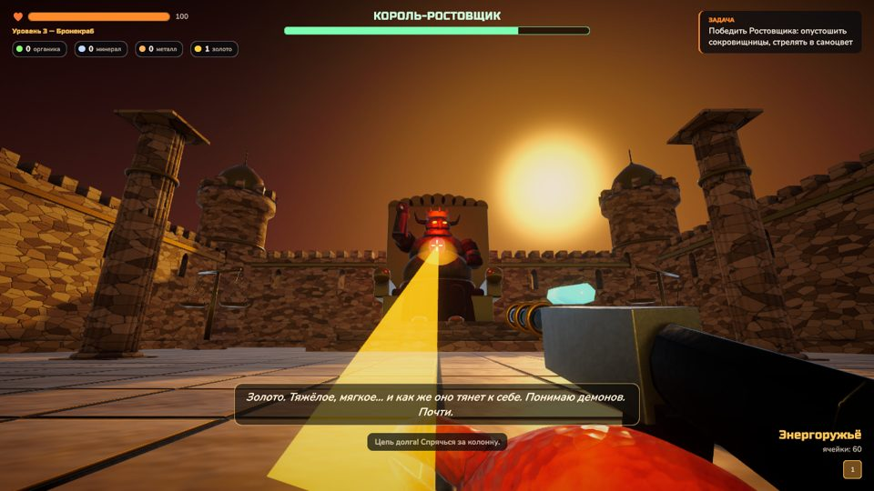
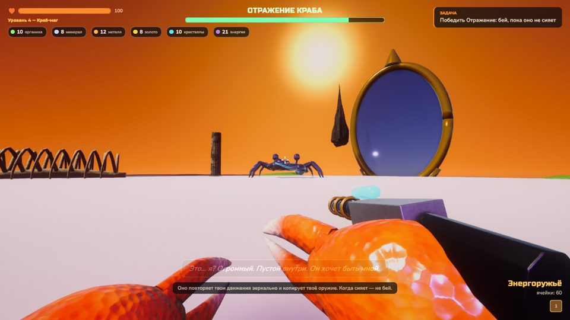
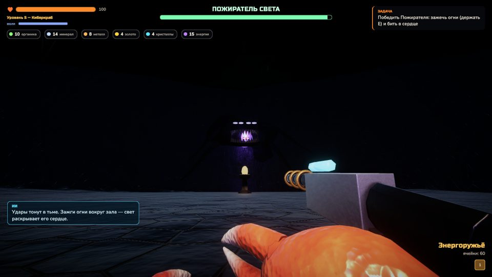
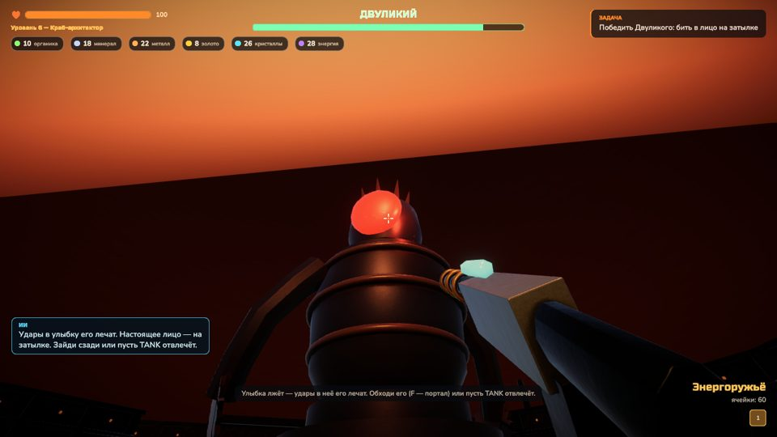
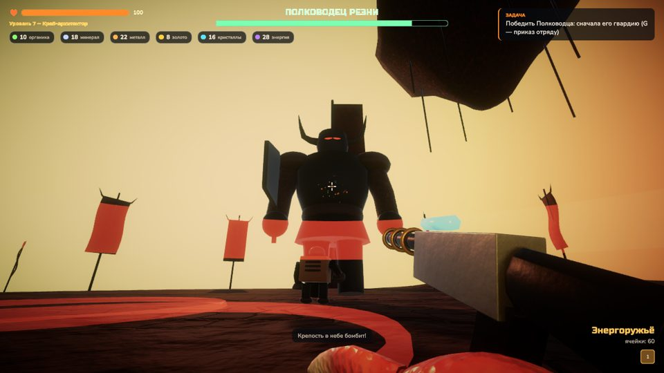

# Краб против ада

Маленький краб, Божья Искра и девять кругов ада. Unity 6.6 (URP), всё художественное — из
Blender-скриптов, образы — по концепт-листу (`Docs/reference/concept.png`). План — [PLAN.md](PLAN.md).

## Состояние

| Этап | Что есть |
|---|---|
| 0. Основа | проект, git + LFS, конвейер Blender → GLB → Unity (glTFast), сцены собираются кодом |
| 1. Пролог и I круг — Лимб | пляж: еда, чайка (спрятаться под плитой), волна, гроза, Божья Искра, первые мысли, втягивание материи, первая палка, разлом. Лимб: мёртвый город в тумане, тени и падальщики, создание предметов (палка, камень, лом, нож, пистолет, патроны) из органики, минерала и металла, три разлома, маяки-сохранения, Страж Лимба — бой от первого лица (луч фонаря, удар с ударной волной, призыв теней, сердце-уязвимость) |
| 2. II круг — Гнев | оранжевые дюны, реки и озеро лавы (обжигает и отбрасывает), вулканы с потоками лавы и дымом, сгоревший город. Бесы (прыжок, удар когтями), землерои (идут под песком, выныривают и кусают), громилы (удар по земле). Пулемёт (автоматический огонь), броня из металлолома (уровень 2 — Краб-воин), дрон SCOUT — первый спутник, сам стреляет по демонам. Три огненных жерла. Огненный Колосс — бой от первого лица: три ядра раскаляются после его атак, залпы огненных шаров с метками на земле, лавовая волна, извержения, призыв бесов |
| 3. III круг — Жадность | золотой город-крепость на тёмной равнине. Новые виды материи: золото, кристаллы, энергия. Краб строит первую мастерскую и собирает в ней тяжёлую броню (уровень 3 — Бронекраб), энергоружьё (пробивает золотые щиты) и энергощит (Q). Сборщики (удирают с мешками золота), золотые стражи (щит спереди держит пули). Золотая дверь сокровищницы берёт плату золотом. Король-Ростовщик — бой от первого лица: купол держится на его золоте (высоси сокровищницы — купол падёт), дождь монет, волна весов, цепь долга (крадёт золото обратно — прячься за колонны), стража. После победы — робот TANK, второй спутник |
| 4. IV круг — Зависть | рай-иллюзия: остров с цветущими деревьями, белыми беседками, бабочками и бирюзовым морем; время от времени иллюзия «мигает» — красное небо, кости и шипы под цветами. Добрые жители с нимбами разговаривают с крабом, а потом от зависти превращаются в Завистников (плюются завистью, мерцают в сторону). Источник на холме: краб становится Краб-магом (уровень 4) — Ядро Искры, материя из энергии (энергия покрывает недостающую органику, минерал и металл, и сама медленно копится), энергоклинок, гравипушка (швыряет врагов), портал (F — шаг сквозь пространство). Отражение Краба — бой от первого лица: огромный зеркальный краб двигается зеркально крабу, копирует его оружие (залп или выпад), щит, портал (оказывается за спиной) и спутника (тёмная копия дрона); когда сияет — возвращает выстрелы; осколки зеркала с неба, призыв Завистников |
| 5. V круг — Уныние | огромная пещера под каменным сводом, почти без света: Искра-фонарь, светящиеся грибы, огни памяти. Во тьме тает воля (мир сереет, краб тяжелеет, шепчет тьма; без воли уходит жизнь), у огня она возвращается. Тоска — невидимые во тьме призраки, их касание отнимает волю. Три осколка памяти — видения на фресках: рыцарь, птица, машина — Искра была до краба. Древняя машина последнего носителя и её ИИ-спутник; Киберкраб (уровень 5): кибер-каркас (лапы на спине, сканер видит Тоску, ИИ вдвое сдерживает уныние), дрон HUNTER (бьёт издалека). Пожиратель Света — бой от первого лица: сердце скрыто во тьме, каждый зажжённый огонь в зале раскрывает его сильнее; он гасит огни, тянет руки из тьмы, шлёт волны отчаяния и бури шёпота |
| 6. VI круг — Предательство | механический лабиринт (генерируется: стены, шестерни, давилки, ворота с рычагами, машинные башни) и первые армии — отряды легиона строем. Проводник ведёт краба по лабиринту; в мастерской легиона краб становится Краб-архитектором (уровень 6): конструктор отряда, несколько спутников сразу — ИНЖЕНЕР (чинит краба и TANK, ставит турели), МАГ (цепная молния, подпитка энергией), улучшения всего отряда (броня, огонь). В сердце лабиринта Проводник предаёт: запирает ворота, сигналом обращает отряд против краба, зовёт легион. Двуликий — бой от первого лица: улыбка лжёт (удары в неё лечат), настоящее лицо на затылке; голова медленно поворачивается к крабу, TANK может отвлечь её; кольца пил, поршни из пола, легион, взлом отряда |
| 7. VII круг — Насилие | поле боя до горизонта: воронки, траншея, баррикады, горящие обломки (из них — металл), знамёна, машинные башни; армии демонов, осадные машины (катапульты бьют горящими камнями, осадная башня катится и высаживает легион), летающие крепости в небе бомбят. Краб-полководец: приказы отряду — G атаковать цель, H ко мне, J держать позицию. Захват кузницы легиона, фабрика роботов (уровень 7) строит армию боевых роботов. Полководец Резни — бой от первого лица: пока стоит его гвардия, красная аура делает его неуязвимым — отряд и армия бьют гвардию по приказу; рассечение землёй, натиск, бомбёжка крепостью |

## Галерея

| | |
|---|---|
|  |  |
|  |  |
|  |  |
|  |  |

## Управление

WASD — идти · мышь — смотреть · Shift — бежать · Пробел — прыжок · ЛКМ — удар/бросок/выстрел ·
ПКМ — прицел · E — втянуть материю / съесть / использовать (держать — для материи и разломов) ·
Tab — создать (круг чертежей) · 1–9, X/Z — оружие · Q — энергощит · F — портал ·
G / H / J — приказы отряду: атаковать цель, ко мне, держать позицию · колесо — дальность камеры · Esc — пауза.
Геймпад: стики, A — прыжок, X — использовать, Y — создать, RT/LT — удар/прицел, бамперы — оружие.

## Как устроено

```
Assets/Crab/
  Scripts/Core/   ядро без Unity: материя, чертежи, инвентарь, здоровье, сохранение (тесты EditMode)
  Scripts/Game/   краб (CrabRig — процедурная анимация частей, CrabController, CameraRig, HeroCombat,
                  MatterPower), враги (Shade, Crawler, Imp, Brute, Burrower, Collector, GoldGuard, Rift, Guardian,
                  Colossus, Usurer, Envious, MirrorCrab, Wraith, Devourer, Janus, Warlord), жители (Dweller), спутники (Drone, TankBot),
                  щит (EnergyShield), портал (PortalStep), мастерская (Workshop), Источник (Spring),
                  иллюзия (IllusionGlitch), уныние (Despair, LightZone, MemoryLamp), видения (MemoryShard),
                  древняя машина и ИИ (AncientMachine), HUNTER, отряд (Squad, EngineerBot, Turret, MageOrb),
                  лабиринт (MechGate, Lever, Crusher, LegionBand, Guide), приказы (Commander), армия
                  (BattleBot, RobotFactory), осада (SiegeEngine, FlyingFortress), лава (LavaZone),
                  сюжет (Prologue, Limbo, Wrath, Greed, Envy, Gloom, Betrayal, Violence),
                  интерфейс (GameUI, MainMenu), звук (Sfx — синтез), эффекты (Fx)
  Editor/         SceneBuilder (Crab → Build Scenes), TextureGen, GroundMesh, Snapshot
  Shaders/        Water, Rift, Glow, Soft, Lava, Sky
  UI/             стили (Crab.uss), шрифты Russo One и Nunito (OFL)
  Models/         GLB из Tools/blender
  Tests/          EditMode (ядро) и PlayMode (пролог, бой, разлом, Страж, пулемёт, жерла, дрон, Колосс, мастерская,
                  энергоружьё, Ростовщик, TANK, жители, маг, Отражение,
                  воля, видения, Киберкраб, Пожиратель,
                  Проводник, отряд, предательство, Двуликий, фабрика и армия,
                  осадные машины, Полководец —
                  в настоящих сценах)
Tools/blender/    lib.py (общие помощники, запекание процедурных материалов в PBR), make_hero.py,
                  make_items.py, make_enemies.py, make_world.py, preview.py
```

- Модели: `blender -b -P Tools/blender/make_world.py -- Assets/Crab/Models/World [имя ...]` (так же hero, items,
  enemies). Каждый ассет — процедурная геометрия + процедурные материалы, запечённые в текстуры (цвет с AO,
  нормали, шероховатость; с VII круга — JPEG в GLB, `CRAB_PNG=1` вернёт PNG). У существ части с началом координат в суставах — их двигает код.
- Сцены (`Menu`, `Prologue`, `Limbo`, `Wrath`, `Greed`, `Envy`, `Gloom`, `Betrayal`, `Violence`) строит `Crab → Build Scenes` (или `-executeMethod Crab.EditorTools.SceneBuilder.BuildAll`);
  руками сцены не правятся — правки вносятся в генератор.
- Снимки: `-executeMethod Crab.EditorTools.Snapshot.All` → `Docs/shots` (JPEG; в git не хранятся, в README — `Docs/gallery`).
- Тесты: `-runTests -testPlatform EditMode` и `PlayMode` (PlayMode пишет снимки с интерфейсом в `Docs/shots/play-*.jpg`).
- Сохранение — `save.json` в `Application.persistentDataPath`; маяки сохраняют игру.
